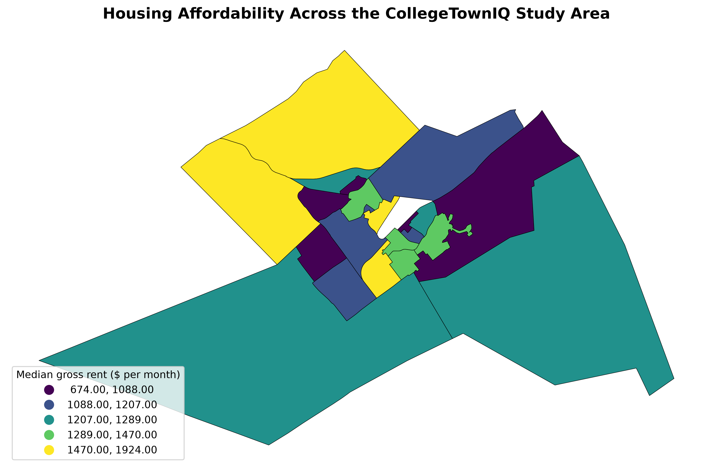
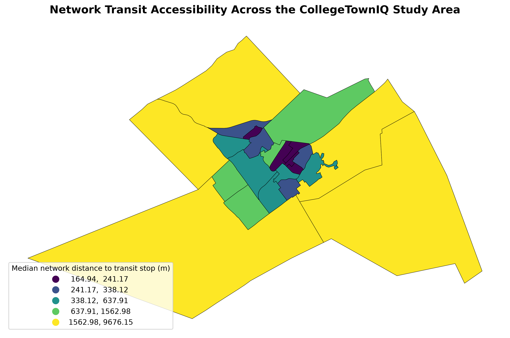
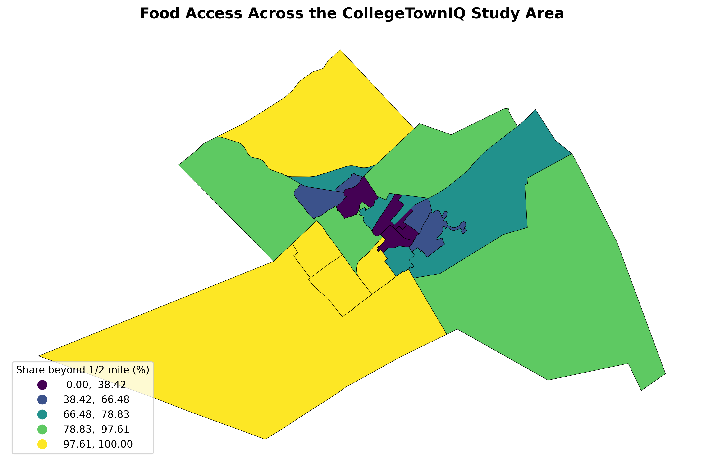

# CollegeTownIQ 🏡

### Exploring housing affordability and accessibility in State College, Pennsylvania

CollegeTownIQ is a data science project I built to explore a question I find interesting as a college student: **Does living in a cheaper area also mean having less convenient access to transportation and other essential resources?**

I used State College, Pennsylvania, as my case study and combined housing, census, public transit, food-access, and geographic data to explore how these factors vary across neighborhoods.

Instead of ranking neighborhoods from best to worst, I wanted to make it easier to explore the tradeoffs between housing costs and accessibility.

## What the project does

- Analyzes housing costs, rent burden, income, and vehicle availability.
- Uses geospatial data to compare differences between census tracts.
- Examines access to CATA public transportation and food resources.
- Uses regression analysis to explore the relationship between housing costs and transit accessibility.
- Tests whether the main findings change under a different transit-distance threshold.
- Includes an interactive dashboard for exploring the study area and comparing census tracts.

## A look at the data

### Housing costs across State College



*Median gross rent by census tract, using 2024 ACS 5-year estimates.*

### Public transit accessibility



*Transit accessibility across the study area. See the methodology and analysis report for details on how the distance measure was calculated.*

### Food access



*Geographic variation in the food-access measure used in the project.*

## Research questions

I built the project around four main questions:

1. How does housing cost vary across the State College area?
2. How does access to public transportation and food resources vary by location?
3. Is housing cost associated with transit accessibility after accounting for other observed characteristics?
4. Do the results change when I use different distance thresholds?

These questions helped me connect data engineering, geospatial analysis, visualization, and statistical modeling in one project.

## What I found

The analysis produced a few findings worth exploring further.

- **Housing and accessibility vary geographically.** Looking at census tracts separately helps reveal differences that a single average for the whole area would hide.
- **The regression showed a negative association between transit-stop distance and median gross rent.** In the primary model, the estimated coefficient was approximately −35.4 dollars per additional kilometer of straight-line distance to the nearest transit stop, conditional on the other included variables.
- **The association was statistically significant in the primary model.** The heteroskedasticity-robust p-value was 0.0066, with an R² of approximately 0.19.
- **The result was similar under the 500-meter sensitivity specification.** The estimated coefficient was approximately −35.3, with a robust p-value of 0.0071.

An important detail: these results describe an **association, not causation**. The analysis does not show that living farther from a transit stop causes rent to decrease. The regression also uses a relatively small sample of 25 census tracts, so the findings should be interpreted cautiously.

The project includes additional regression diagnostics and spatial residual analysis to investigate how reliable the results are.

## Study area

The study area covers five municipalities in the State College region:

- State College Borough
- College Township
- Ferguson Township
- Harris Township
- Patton Township

The geospatial dataset contains 28 census tracts, while the primary regression uses 25 complete observations.

## Tools and technologies

| Tool | How I used it |
|---|---|
| Python | Data processing and analysis |
| pandas and NumPy | Cleaning, combining, and analyzing data |
| GeoPandas and Shapely | Working with geographic data |
| OSMnx and NetworkX | Working with pedestrian-network data |
| Statsmodels and SciPy | Regression and statistical diagnostics |
| Matplotlib | Maps and visualizations |
| GeoJSON, HTML, CSS, and JavaScript | Interactive dashboard |
| Git and GitHub | Version control and project documentation |

## Data sources

The project brings together several public datasets:

- **U.S. Census Bureau — ACS 2024 5-Year Estimates:** Rent, household income, rent burden, and vehicle availability.
- **CATA GTFS:** Public transit stops and scheduled service.
- **USDA Food Access Research Atlas / SRAM:** Food-access measures.
- **Census TIGER/Line:** Census tract boundaries.
- **Centre County GIS:** Geographic boundaries used to define the study area.
- **OpenStreetMap:** Street-network data used in accessibility analysis.

## How the project is organized

```text
CollegeTownIQ/
├── dashboard/
│   ├── index.html
│   └── data/
├── data/
│   ├── raw/
│   └── processed/
├── docs/
│   ├── figures/
│   ├── analysis_report.md
│   ├── research_findings.md
│   └── data_quality_report.csv
├── src/
│   ├── ingestion/
│   ├── cleaning/
│   ├── geospatial/
│   └── analysis/
├── requirements.txt
└── README.md
```

*This is a simplified overview of the main project folders.*

## Running the project

The project was developed in Python using a virtual environment.

1. Clone the repository and open the project folder.
2. Create and activate a Python virtual environment.
3. Install the dependencies listed in `requirements.txt`.
4. Follow the processing scripts in `src/ingestion/`, `src/cleaning/`, and `src/geospatial/` to prepare the data.
5. Run the relevant scripts in `src/analysis/` to reproduce the analysis and visualizations.
6. Open `dashboard/index.html` in a local web server to explore the dashboard.

Some processing steps depend on the source datasets and intermediate files being available in the expected locations.

## Limitations and next steps

This is a student research project, so there are several limitations I want to be clear about:

- The regression sample is small, with 25 complete tract-level observations.
- Some variables have missing data.
- Census-tract averages do not describe every household or individual within a tract.
- Straight-line distance and pedestrian-network distance measure different things; neither should automatically be interpreted as actual travel time.
- Observational regression cannot establish a causal relationship between transit accessibility and rent.

Possible next steps include improving the treatment of missing data, exploring additional explanatory variables, and making the dashboard more useful for comparing locations.

## Why this project matters to me

I wanted to build something that connected data science to a real place and a practical problem, rather than just analyze a dataset and stop at a few charts.

CollegeTownIQ gave me an opportunity to work through the full process: collecting data, cleaning it, combining geographic datasets, engineering features, running statistical models, checking assumptions, and presenting the results in an interactive dashboard.

It is still a work in progress, but it has helped me understand how different parts of a data science project fit together.

---

*Built as a personal data science project focused on housing affordability, transportation accessibility, and life in a college town.*
