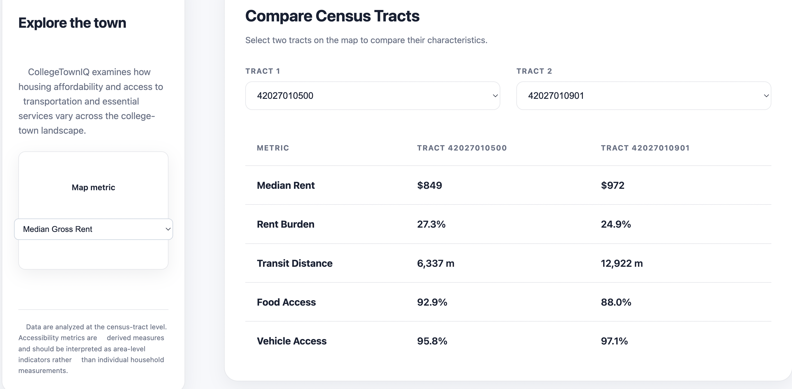
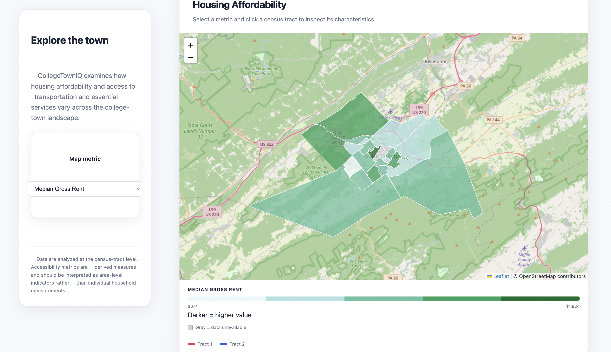
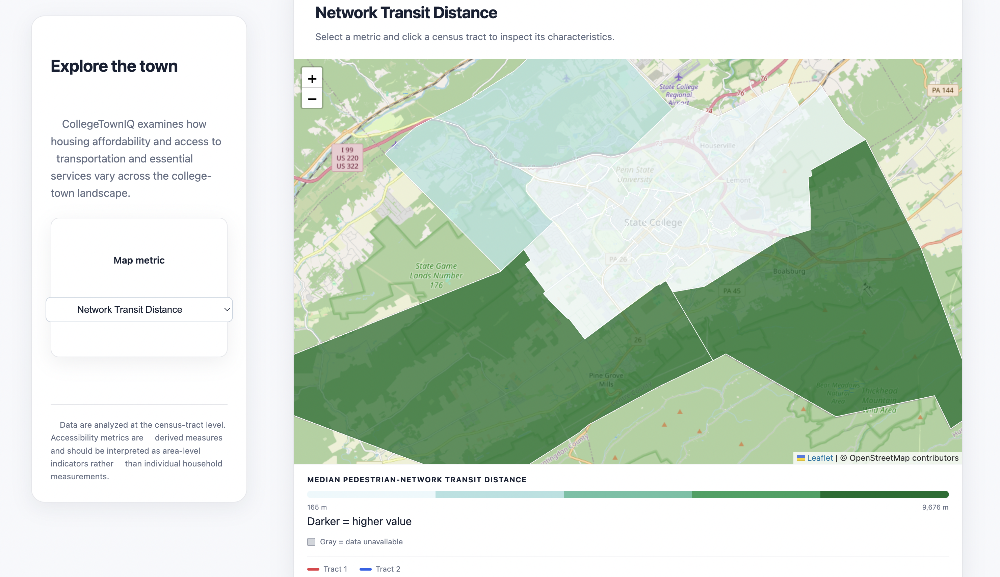
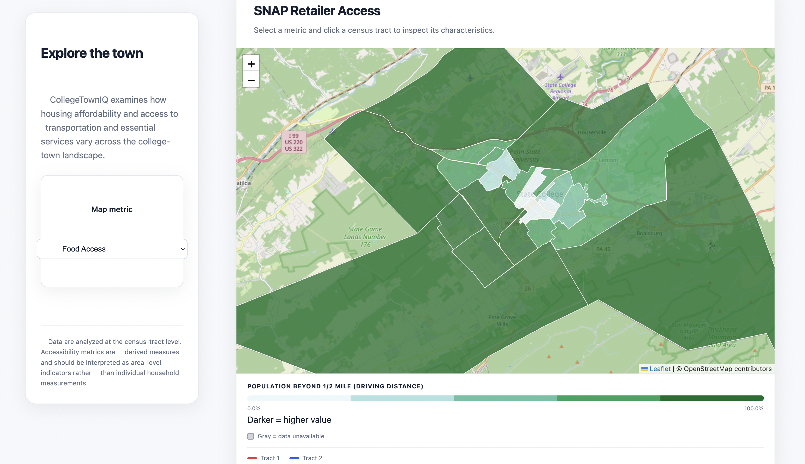

# CollegeTownIQ 🏡

### Exploring Housing Affordability and Accessibility in State College, Pennsylvania

**[🌐 Explore the Live Dashboard](https://mannat-sadana.github.io/CollegeTownIQ/dashboard/)** · [View Source Code](https://github.com/Mannat-Sadana/CollegeTownIQ)

**Headline finding:** Across 21 census tracts with complete data, the analysis found no statistically significant association between distance to the nearest CATA transit stop and median gross rent after controlling for household income and vehicle access. The model explains approximately 2.9% of the observed variation in rent, highlighting the limitations of using a small set of tract-level characteristics to explain housing costs.

## Overview

CollegeTownIQ is a data science project exploring how housing affordability and access to public transportation and essential resources vary across the State College, Pennsylvania area.

Rather than relying on a single regional average, I combined census, transit, food-access, and geographic data to examine differences between neighborhoods. The project brings together data engineering, geospatial analysis, statistical modeling, and interactive visualization.

## Explore the Dashboard

The interactive dashboard lets you explore housing and accessibility patterns geographically, inspect census-tract metrics, and compare two tracts.


*Explore housing affordability across census tracts.*



*Compare tracts across housing costs, transit distance, food access, and vehicle access.*

## Key Findings

The study area covers **23 census tracts** across five municipalities. The primary regression uses **21 complete observations** because two tracts have missing values in the required ACS housing and socioeconomic variables.

| Measure | Result |
|---|---:|
| Census tracts in study area | 23 |
| Complete observations in primary regression | 21 |
| Median tract-level gross rent | $1,214/month |
| Median tract-level household income | $84,063/year |
| Median tract-level sampled straight-line transit distance (all 23 tracts) | 282.7 m |
| Primary model R² | 0.029 |
| Transit-distance coefficient | +$0.518 per additional km |
| Robust p-value for transit distance | 0.9884 |

*Housing and socioeconomic measures use the 2024 American Community Survey (ACS) 5-Year Estimates. The reported rent and income figures are medians of tract-level estimates, not individual household values.*

### Interpreting the results

- **Housing costs vary geographically.** Median gross rent ranges from $674 to $1,924 per month across the observed tracts.
- **The transit–rent association is not statistically significant.** After controlling for median household income and vehicle access, the estimated transit-distance coefficient is close to zero.
- **Other factors may matter.** Housing characteristics, neighborhood amenities, land use, and other unobserved conditions may help explain differences in rent.
- **Robustness checks provide additional context.** Alternative sampling resolutions, influence checks, and spatial residual diagnostics did not establish a statistically significant transit–rent relationship in the tested models.

These findings do not prove that transit accessibility has no relationship with housing costs. They indicate that this analysis does not provide sufficient evidence of an association under the tested model and data.

## Methodology

I developed a geospatial workflow to combine public datasets, calculate tract-level measures, and evaluate relationships between housing costs and accessibility.

1. **Data integration:** Combined ACS estimates, CATA transit data, food-access measures, census boundaries, and geographic datasets.
2. **Study-area construction:** Defined the study area using State College Borough, College Township, Ferguson Township, Harris Township, and Patton Township.
3. **Geospatial processing:** Selected census tracts using a majority-area-overlap rule and calculated housing, socioeconomic, and accessibility features.
4. **Accessibility analysis:** Estimated straight-line transit distances using sampled grids and compared results with pedestrian-network distances.
5. **Statistical modeling:** Used multivariable regression to examine median gross rent in relation to transit distance, household income, and vehicle access.
6. **Diagnostics and sensitivity analysis:** Examined influential observations, alternative sampling resolutions, and spatial autocorrelation in model residuals.

### Additional accessibility analysis

The project compares straight-line distance with pedestrian-network distance to illustrate why geographic proximity does not necessarily equal walking distance. The two measures were strongly correlated in the tested data, but network distances were longer on average.

Spatial residual analysis did not detect statistically significant spatial autocorrelation in the tested model. This diagnostic does not establish that all spatial dependence is absent.

## Maps and Accessibility Measures

### Housing costs



*Median gross rent by census tract, based on 2024 ACS 5-Year Estimates.*

### Public transportation



*Transit accessibility using geographic and pedestrian-network distance measures.*

### Food accessibility



*Geographic variation in the food-access measure used in the project.*

## Data Sources

| Source | Use |
|---|---|
| [U.S. Census Bureau — ACS](https://www.census.gov/programs-surveys/acs) | Median gross rent, household income, rent burden, and vehicle availability |
| Centre Area Transportation Authority (CATA) GTFS | Transit stops, trips, schedules, and stop events |
| [USDA Food Access Research Atlas](https://www.ers.usda.gov/data-products/food-access-research-atlas/) and related food-access data | Food-access measures |
| [Census TIGER/Line](https://www.census.gov/geographies/mapping-files/time-series/geo/tiger-line-file.html) | Census tract boundaries |
| Centre County GIS | Municipal boundaries for defining the study area |
| [OpenStreetMap](https://www.openstreetmap.org/) | Street-network data for pedestrian accessibility analysis |

## Tools and Technologies

| Tool | Purpose |
|---|---|
| Python, pandas, NumPy | Data cleaning, processing, and feature engineering |
| GeoPandas, Shapely | Geospatial data processing |
| OSMnx, NetworkX | Pedestrian-network analysis |
| Statsmodels, SciPy | Regression and statistical diagnostics |
| Matplotlib | Maps and analytical visualizations |
| HTML, CSS, JavaScript | Interactive dashboard |
| GeoJSON | Geographic data export |
| Git, GitHub | Version control and project hosting |

## Project Structure

```text
CollegeTownIQ/
├── dashboard/
│   ├── index.html
│   └── data/
├── data/
│   ├── raw/
│   └── processed/
├── docs/
│   ├── figures/
│   ├── analysis_report.md
│   ├── research_findings.md
│   └── missing_data_details.csv
├── src/
│   ├── ingestion/
│   ├── cleaning/
│   ├── geospatial/
│   └── analysis/
├── requirements.txt
└── README.md
```

This is a simplified overview. The `src/` directory contains processing and analysis scripts, `data/` holds source and processed datasets, and `docs/` contains reports and generated figures.

## Running the Project Locally

### 1. Set up the environment

Clone the repository and install the Python dependencies:

```bash
git clone https://github.com/Mannat-Sadana/CollegeTownIQ.git
cd CollegeTownIQ

python3 -m venv .venv
source .venv/bin/activate

python -m pip install -r requirements.txt
```

### 2. Explore the dashboard

The dashboard uses the exported GeoJSON file at `dashboard/data/college_town_data.geojson`. You can explore the live version without running the analysis locally:

**[Open the CollegeTownIQ Dashboard →](https://mannat-sadana.github.io/CollegeTownIQ/dashboard/)**

To preview it locally, start a server from the repository root:

```bash
python -m http.server 8000
```

Then open [http://localhost:8000/dashboard/](http://localhost:8000/dashboard/) in your browser.

### 3. Reproduce the analysis

Reproducing the complete workflow requires the original source datasets and intermediate files expected by the scripts. Some raw data and processed outputs are not tracked in Git.

Broadly, the workflow involves:

1. Preparing ACS data and constructing the census-tract dataset.
2. Building the study area and processing CATA transit data.
3. Calculating transit accessibility and assembling the analysis dataset.
4. Building pedestrian-network and food-access measures.
5. Running statistical analyses and diagnostic checks.
6. Exporting dashboard data and regenerating figures.

Ensure the required ACS data, Census TIGER/Line files, CATA GTFS data, and food-access datasets are available at the paths expected by the scripts. Refer to individual scripts for their input paths, parameters, and output filenames.

## Limitations and Future Improvements

Several limitations affect how the findings should be interpreted:

- **Small sample:** The primary regression includes 21 complete census-tract observations.
- **Missing data:** Two tracts lack required ACS values in the source data and are excluded from the complete-case regression.
- **Observational design:** The analysis identifies associations, not causal effects.
- **Geographic aggregation:** Census-tract estimates do not describe every household or individual within a tract.
- **Accessibility assumptions:** Straight-line and pedestrian-network distances do not directly capture actual travel time, transit frequency, service quality, or individual travel needs.
- **Unobserved factors:** Housing characteristics, land use, neighborhood amenities, and other conditions may influence rent.

Future improvements could incorporate additional explanatory variables, refine accessibility measures, and expand the geographic scope to support a larger sample.

## What I Learned

Building CollegeTownIQ helped me connect the stages of a data science project—from data collection and cleaning to geospatial feature engineering, statistical modeling, diagnostics, and interactive visualization.

An important lesson was that a technically complete workflow does not guarantee a statistically significant result. Documenting missing data, testing model assumptions, and communicating uncertainty are just as important as building the model or dashboard.

---

*CollegeTownIQ is an independent student data science project exploring housing affordability and accessibility in the State College, Pennsylvania area.*